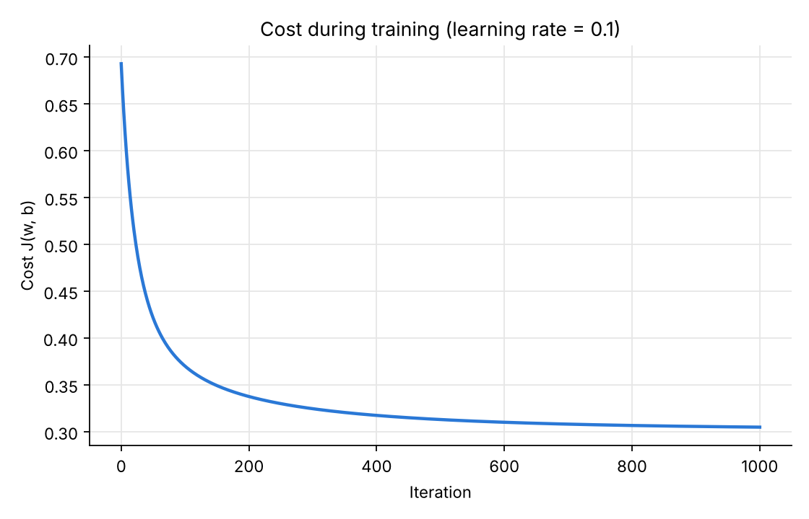
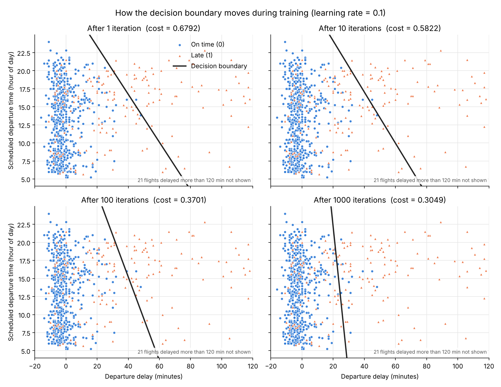

# Can We Predict a Late Flight Using Just Two Numbers?

**MAI 600 — Mathematics and Statistics for AI**  
**Rajeev Ranjan Pandey · Hussein Aboueldahab**  
Canadian University Dubai · November 2026

---

We built a logistic regression classifier completely from scratch — no scikit-learn, no TensorFlow, no shortcuts — that looks at a flight's departure delay and scheduled departure hour and decides: will this flight arrive late?

By the end of training, the model correctly identified 92% of the 200 test flights it had never seen before.

The sections below cover the full implementation: the dataset, the math, the training procedure, and what each of the six figures actually shows.

---

## The Starting Point: Why Build It from Scratch?

Machine learning libraries like scikit-learn are genuinely useful. But when we call `LogisticRegression().fit(X, y)`, we hand the problem to a black box. We get a number at the end, but we lose the understanding of *why* that number comes out.

The assignment for MAI 600 required that we implement the prediction function, the cost function, the gradient computation, the training loop, the train/test split, the feature scaling, and all evaluation metrics by hand. No shortcuts. That constraint turned out to be the most educational part of the project.

When we had to derive the gradient ourselves, we stopped thinking of it as a formula and started understanding it as a physical thing: the direction the cost surface slopes at your current position, telling you which way to step.

---

## The Dataset: Flights Out of New York City

We used the **nycflights13** dataset, which records every commercial flight that departed New York City's three airports — JFK, LaGuardia, and Newark — during 2013. The full dataset has 336,776 flights. We sampled 1,000 of them at random (seed 42, so the sample is exactly reproducible).

We picked this dataset deliberately. We wanted a problem where the relationship between the features and the prediction makes physical sense — something we could explain to a non-technical person and have them nod along.

**The two features we used:**

- **Departure delay** (`dep_delay_min`): how many minutes late the flight actually left. Negative means it departed early. The range in our sample runs from early departures to flights delayed by several hours.
- **Scheduled departure hour** (`sched_dep_hour`): the time of day the flight was supposed to leave, expressed as a decimal. A 15:45 departure becomes 15.75.

**The target:** a flight is classified as *late* if it arrives 15 minutes or more behind schedule. That 15-minute threshold is the standard industry definition used by regulators and airlines worldwide. It is not arbitrary.

Of our 1,000 sampled flights, **243 arrive late** and **757 arrive on time** — a 24.3% minority class. That imbalance matters and we will come back to it.

---

## Preparing the Data

### Splitting into training and test sets

Before we train anything, we set aside 200 flights as a test set that the model will never see during training. We use the remaining 800 to learn from.

The split is *stratified*: we divide the late flights and the on-time flights separately before splitting, so both the training set and the test set end up with approximately 24.3% late arrivals. Without stratification, we could get unlucky and end up with 90% of late flights in training and almost none in the test set, which would make our evaluation misleading.

| Split | Total | Late (class 1) | On time (class 0) | Late rate |
|---|---|---|---|---|
| Full dataset | 1,000 | 243 | 757 | 24.3% |
| Training set | 800 | 194 | 606 | 24.3% |
| Test set | 200 | 49 | 151 | 24.5% |

### Standardizing the features

Departure delay ranges from roughly −60 to +1,000 minutes. Scheduled departure hour runs from 5 to 23. These are completely different scales.

If we feed raw numbers into gradient descent, the algorithm struggles. The weight for departure delay needs to change much more than the weight for departure hour per iteration, so no single learning rate works well for both simultaneously. The loss surface becomes elongated and hard to navigate.

The fix is **z-score standardization**: for each feature, subtract its training mean and divide by its training standard deviation.

```
z = (x − mean_train) / std_train
```

After this, both features have zero mean and unit variance. The loss surface is rounder, the gradient steps are balanced, and training converges much more smoothly.

One discipline matters here: the mean and standard deviation are computed from the **training set only**. If we computed them from the full dataset before splitting, the test set would have implicitly influenced the normalization, which counts as data leakage. Our reported accuracy figures would be slightly optimistic — not by much, but it is the right habit.

Training statistics: mean = [11.68 min, 13.48 h], std = [38.16 min, 4.66 h].

---

## The Mathematics

This is the section most README files skip. We are not going to skip it.

### Step 1: The prediction

Logistic regression starts with a straight line through feature space:

```
z = w1 × dep_delay_std + w2 × sched_dep_hour_std + b
```

Here `w1` and `w2` are weights (numbers we learn from data), and `b` is a bias term. We start with all three set to zero.

The problem is that `z` can be any real number, but we want a probability between 0 and 1. The **sigmoid function** handles that:

```
σ(z) = 1 / (1 + e^(−z))
```

The sigmoid is an S-shaped curve. When `z` is very large and positive, `σ(z)` approaches 1. When `z` is very large and negative, `σ(z)` approaches 0. At `z = 0`, `σ(z) = 0.5`.

We interpret `σ(z)` as the model's estimated probability that the flight arrives late. We classify a flight as late when that probability is 0.5 or higher — equivalently, when `z ≥ 0`.

### Step 2: The cost function

Training means adjusting `w1`, `w2`, and `b` until the model's predictions are as close to the true labels as possible. We need a way to measure how wrong the model currently is. That measure is the **binary cross-entropy** (also called log loss):

```
J(w, b) = −(1/m) × Σ [ y × log(ŷ) + (1 − y) × log(1 − ŷ) ]
```

where `m` is the number of training examples, `y` is the true label (0 or 1), and `ŷ = σ(z)` is the predicted probability.

The intuition is straightforward. When a flight is actually late (`y = 1`) and the model predicted a low probability of being late, `−log(ŷ)` becomes very large — heavy penalty. When a flight is on time (`y = 0`) and the model said it was probably late, `−log(1 − ŷ)` blows up — heavy penalty again. Confident correct predictions get very small loss. The model is pushed to be both accurate and confident.

Binary cross-entropy is **strictly convex** in the weights. That means the loss surface has exactly one minimum. Gradient descent will always find it, regardless of where it starts. When `w = 0` and `b = 0`, every prediction is exactly 0.5, giving an initial cost of `−log(0.5) = log(2) ≈ 0.6931`. Every run should start here.

### Step 3: Deriving the partial derivatives

To descend the cost surface, we need the **partial derivatives** of `J` with respect to each parameter: how much does the cost change if we nudge `w1`, `w2`, or `b` by a tiny amount?

Applying the chain rule through the loss → sigmoid → linear combination gives a surprisingly clean result:

```
∂J/∂w = (1/m) × Xᵀ × (ŷ − y)      [vectorized form]
∂J/∂b = (1/m) × sum(ŷ − y)
```

The term `(ŷ − y)` is the residual — the gap between what the model predicted and what actually happened. The partial derivative with respect to each weight is simply the average residual across all training examples, weighted by that feature's value. This is structurally identical to the gradient in linear regression, and that is not a coincidence: it falls out of using cross-entropy loss with a sigmoid output.

### Step 4: The gradient descent update

Each iteration, we move the parameters a small step in the direction opposite to the gradient:

```
w := w − α × ∂J/∂w
b := b − α × ∂J/∂b
```

where `α` is the **learning rate** — a positive number that controls how large each step is. Too large and the updates overshoot the minimum; too small and convergence is painfully slow. We run this for 1,000 iterations using all 800 training examples in every step — this is **batch gradient descent**, as opposed to stochastic or mini-batch variants that use a random subset each iteration.

---

## Verifying the Math Before Training

Before spending time on training, we ran a numerical gradient check. For each parameter, we estimated the gradient by perturbing it by a tiny amount `ε = 1e−6` in both directions:

```
numerical_gradient ≈ (J(θ + ε) − J(θ − ε)) / (2ε)
```

We then compared this to our analytical gradient at the same parameter values. The maximum absolute difference across all three parameters was **2.99 × 10⁻¹¹** — consistent with floating-point precision for double-precision numbers. The derivation was correct.

This sanity check is worth running before any training loop. A gradient error will silently push the model in the wrong direction, and the cost curves will look plausible while the final weights are wrong.

---

## Results

### The model learned the right boundary

After 1,000 iterations at learning rate 0.1, the model converged to:

| Parameter | Value |
|---|---|
| w1 (departure delay weight) | 3.215 |
| w2 (scheduled departure hour weight) | 0.190 |
| b (bias) | −1.055 |

The weight on departure delay is about **17 times larger** than the weight on departure hour. The model learned, entirely from data, that departure delay is the dominant signal — which matches physical intuition.

### On 200 test flights it had never seen:

| Metric | Value |
|---|---|
| Accuracy | **92.0%** |
| Precision | 92.3% |
| Recall | 73.5% |
| F1-score | 81.8% |

The confusion matrix:

| | Predicted: on time | Predicted: late |
|---|---|---|
| **Actual: on time** | 148 (true negative) | 3 (false positive) |
| **Actual: late** | 13 (false negative) | 36 (true positive) |

The model caught 36 of 49 late flights while raising only 3 false alarms. The 13 it missed were flights that departed close to on time but still arrived late — delay that accumulated in the air rather than on the ground, which a linear boundary on two features cannot capture.

---

## The Six Visualizations

All six figures are generated by running `logistic_regression.py`.

### Figure 1: Confusion Matrix


**What it shows:** The 200 test predictions split into four quadrants.

**What we observed:** The dominant cell is true negatives (148). False alarms are very rare (3 out of 151 on-time flights). The main cost is false negatives: 13 of 49 late flights were missed, a natural consequence of class imbalance.

---

### Figure 2: Training Data Scatter


**What it shows:** Each training flight in feature space: departure delay on the horizontal axis, scheduled hour on the vertical.

**What we observed:** The two classes separate clearly along the horizontal axis. Late flights (orange triangles) cluster beyond roughly 20 minutes of delay; on-time flights (blue circles) cluster near zero. Scheduled departure hour shows much weaker separation — the boundary will end up nearly vertical.

---

### Figure 3: Learning Curve



**What it shows:** Binary cross-entropy cost at each of the 1,000 iterations.

**What we observed:** Cost drops from 0.693 to about 0.370 by iteration 100, then continues more slowly to 0.305 at iteration 1,000. A reference run at 50,000 iterations reaches 0.302 — our model is effectively converged well before 1,000 steps.

---

### Figure 4: Final Decision Boundary


**What it shows:** Test flights with the learned boundary overlaid.

**What we observed:** A nearly vertical line at roughly 20 minutes of departure delay, with a slight negative slope from the small departure-hour weight. The 3 false positives sit to its right; the 13 false negatives to its left.

---

### Figure 5: Boundary Evolution



**What it shows:** Four snapshots of the boundary during training.

**What we observed:** At iteration 1 the boundary is nearly flat. By iteration 10 it has started rotating. By iteration 100 it is already close to its final position. The change between 100 and 1,000 is small — most learning happens early.

---

### Figure 6: Learning Rate Comparison


**What it shows:** Cost curves for α = 0.1, 0.01, and 0.001 on the same axes.

**What we observed:**

| Learning rate | Cost at 1,000 | Accuracy | F1-score |
|---|---|---|---|
| 0.1 | 0.305 | **92.0%** | **81.8%** |
| 0.01 | 0.371 | 90.5% | 75.9% |
| 0.001 | 0.583 | 90.0% | 74.4% |

All three curves decrease throughout — none diverges. The difference is speed. At α = 0.01, convergence is about ten times slower; at α = 0.001, the model has barely moved after 1,000 iterations. The two slower rates produce 100% precision but very low recall because they have not converged: the model defaults to predicting on time for most examples. F1-score captures the tradeoff in a single number.

---

## Full Numerical Summary

### Cost across learning rates

| Alpha | Iter 0 | Iter 1 | Iter 10 | Iter 100 | Iter 1,000 |
|---|---|---|---|---|---|
| 0.1 | 0.6931 | 0.6792 | 0.5822 | 0.3701 | 0.3049 |
| 0.01 | 0.6931 | 0.6917 | 0.6793 | 0.5832 | 0.3705 |
| 0.001 | 0.6931 | 0.6930 | 0.6917 | 0.6794 | 0.5833 |

All three start at log(2) = 0.6931 — the cost when every prediction is exactly 0.5.

### Full performance comparison (1,000 iterations)

| Learning rate | Final cost | Train acc. | Test acc. | Precision | Recall | F1-score |
|---|---|---|---|---|---|---|
| **0.1** | **0.3049** | **88.9%** | **92.0%** | **92.3%** | **73.5%** | **81.8%** |
| 0.01 | 0.3705 | 86.9% | 90.5% | 100.0% | 61.2% | 75.9% |
| 0.001 | 0.5833 | 85.9% | 90.0% | 100.0% | 59.2% | 74.4% |

### Learned parameters (α = 0.1, 1,000 iterations)

| Parameter | Value |
|---|---|
| w1 — departure delay (standardized) | 3.215 |
| w2 — departure hour (standardized) | 0.190 |
| b — bias | −1.055 |
| Gradient check: max absolute error | 2.99 × 10⁻¹¹ |
| Reference run cost (50,000 iterations) | 0.3024 |

The 50,000-iteration reference converges to `w1 = 3.853, w2 = 0.143, b = −0.964`. Our 1,000-iteration model is approaching these values: departure delay is on a convergent trajectory, departure hour is already close, and the boundary position and slope are effectively the same.

---

## What We Would Do Differently

**Two features is limiting.** Departure delay explains most late arrivals, but some flights depart on time and still arrive late — headwinds, congested routes, tight turnarounds. Distance, carrier history, and time of year would sharpen the model.

**Linear boundary.** Logistic regression draws a straight line. The small cluster of on-time flights that departed late but recovered time is simply unreachable with this model family.

**Small sample.** 1,000 flights is a thin slice of 336,776. Metrics would be more stable across random seeds on a larger sample.

**Single split.** We report results for one fixed 80/20 split. Cross-validation would give a tighter estimate of generalisation performance.

---

## Running the Code

```bash
pip install numpy pandas matplotlib
python logistic_regression.py
```

The CSV is included in the repository. `prepare_dataset.py` only needs to be run to rebuild the dataset from scratch (requires `pip install nycflights13` first).

Running `logistic_regression.py` will:
1. Load and standardize the data
2. Run the gradient verification check (should report ~3e-11)
3. Train at all three learning rates
4. Evaluate on the test set
5. Write all six figures to `figures/`
6. Write all metrics to `results.json`

---

## Files

| File | What it does |
|---|---|
| `logistic_regression.py` | Full implementation — model, training, evaluation, all six plots |
| `prepare_dataset.py` | Samples 1,000 flights from nycflights13 and saves the CSV |
| `flights_two_features.csv` | The 1,000-flight dataset |
| `results.json` | Every metric for every learning rate, written by the main script |
| `figures/` | The six PNG figures |

---

## Group Members

| Name | Contributions |
|---|---|
| Rajeev Ranjan Pandey | Dataset selection, feature engineering, mathematical derivation of all five formulas, model class implementation (sigmoid, fit, predict), all six visualizations, report writing |
| Hussein Aboueldahab | Data preprocessing (stratified split, z-score standardization), evaluation metrics from scratch (accuracy, precision, recall, F1, confusion matrix), learning rate comparison experiment, results analysis and discussion, report review |

---

## Data Source

nycflights13 — all flights that departed New York City's three airports in 2013.  
https://github.com/tidyverse/nycflights13
