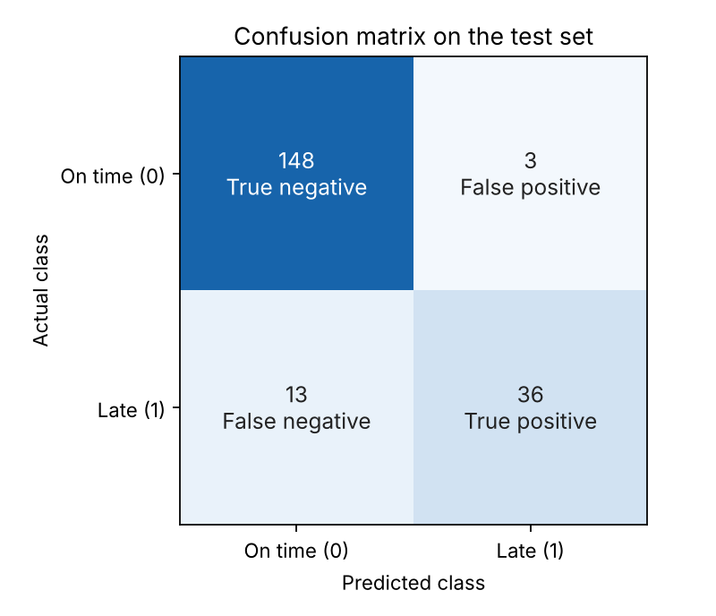
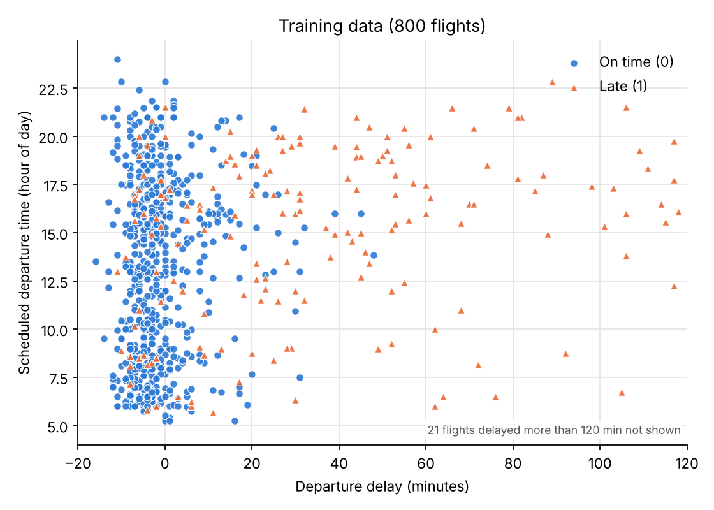
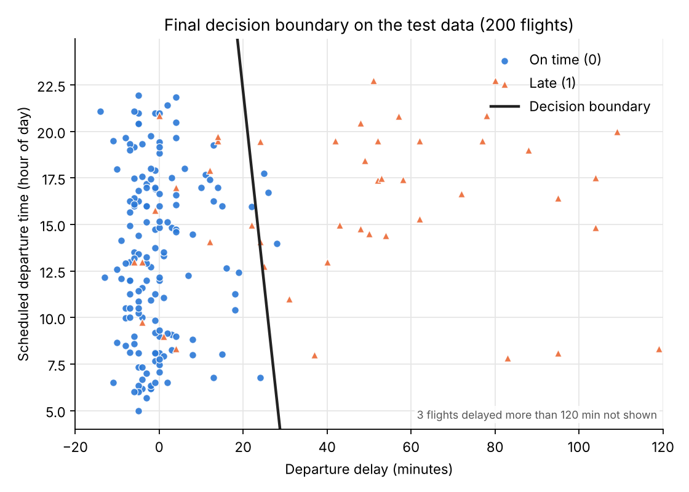
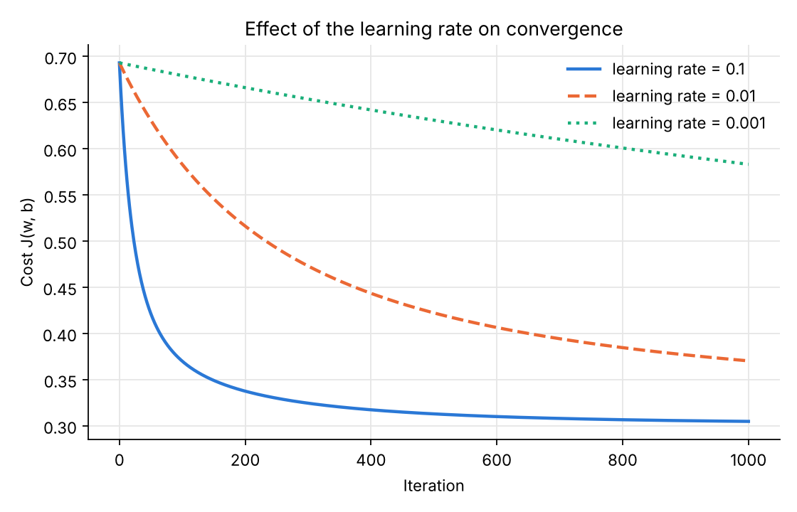

# Can We Predict a Late Flight Using Just Two Numbers?

**MAI 600 — Mathematics and Statistics for AI**  
**Rajeev Ranjan Pandey · Hussein Aboueldahab**  
Canadian University Dubai · November 2026

---

We built a logistic regression classifier completely from scratch — no scikit-learn, no TensorFlow, no shortcuts — that looks at a flight's departure delay and scheduled departure hour and decides: will this flight arrive late?

By the end of training, the model correctly identified 92% of the 200 test flights it had never seen before.

The sections below cover the full implementation: the dataset, the math, the training procedure, and what each of the six figures actually shows.

---

## The Starting Point: Why Build It from Scratch?

Machine learning libraries like scikit-learn are genuinely useful. But when we call `LogisticRegression().fit(X, y)`, we hand the problem to a black box. We get a number at the end, but we lose the understanding of *why* that number comes out.

The assignment for MAI 600 required that we implement the prediction function, the cost function, the gradient computation, the training loop, the train/test split, the feature scaling, and all evaluation metrics by hand. No shortcuts. That constraint turned out to be the most educational part of the project.

When we had to derive the gradient ourselves, we stopped thinking of it as a formula and started understanding it as a physical thing: the direction the cost surface slopes at your current position, telling you which way to step.

---

## The Dataset: Flights Out of New York City

We used the **nycflights13** dataset, which records every commercial flight that departed New York City's three airports — JFK, LaGuardia, and Newark — during 2013. The full dataset has 336,776 flights. We sampled 1,000 of them at random (seed 42, so the sample is exactly reproducible).

We picked this dataset deliberately. We wanted a problem where the relationship between the features and the prediction makes physical sense — something we could explain to a non-technical person and have them nod along.

**The two features we used:**

- **Departure delay** (`dep_delay_min`): how many minutes late the flight actually left. Negative means it departed early. The range in our sample runs from early departures to flights delayed by several hours.
- **Scheduled departure hour** (`sched_dep_hour`): the time of day the flight was supposed to leave, expressed as a decimal. A 15:45 departure becomes 15.75.

**The target:** a flight is classified as *late* if it arrives 15 minutes or more behind schedule. That 15-minute threshold is the standard industry definition used by regulators and airlines worldwide. It is not arbitrary.

Of our 1,000 sampled flights, **243 arrive late** and **757 arrive on time** — a 24.3% minority class. That imbalance matters and we will come back to it.

---

## Preparing the Data

### Splitting into training and test sets

Before we train anything, we set aside 200 flights as a test set that the model will never see during training. We use the remaining 800 to learn from.

The split is *stratified*: we divide the late flights and the on-time flights separately before splitting, so both the training set and the test set end up with approximately 24.3% late arrivals. Without stratification, we could get unlucky and end up with 90% of late flights in training and almost none in the test set, which would make our evaluation misleading.

| Split | Total | Late (class 1) | On time (class 0) | Late rate |
|---|---|---|---|---|
| Full dataset | 1,000 | 243 | 757 | 24.3% |
| Training set | 800 | 194 | 606 | 24.3% |
| Test set | 200 | 49 | 151 | 24.5% |

### Standardizing the features

Departure delay ranges from roughly −60 to +1,000 minutes. Scheduled departure hour runs from 5 to 23. These are completely different scales.

If we feed raw numbers into gradient descent, the algorithm struggles. The weight for departure delay needs to change much more than the weight for departure hour per iteration, so no single learning rate works well for both simultaneously. The loss surface becomes elongated and hard to navigate.

The fix is **z-score standardization**: for each feature, subtract its training mean and divide by its training standard deviation.

```
z = (x − mean_train) / std_train
```

After this, both features have zero mean and unit variance. The loss surface is rounder, the gradient steps are balanced, and training converges much more smoothly.

One discipline matters here: the mean and standard deviation are computed from the **training set only**. If we computed them from the full dataset before splitting, the test set would have implicitly influenced the normalization, which counts as data leakage. Our reported accuracy figures would be slightly optimistic — not by much, but it is the right habit.

Training statistics: mean = [11.68 min, 13.48 h], std = [38.16 min, 4.66 h].

---

## The Mathematics

This is the section most README files skip. We are not going to skip it.

### Step 1: The prediction

Logistic regression starts with a straight line through feature space:

```
z = w1 × dep_delay_std + w2 × sched_dep_hour_std + b
```

Here `w1` and `w2` are weights (numbers we learn from data), and `b` is a bias term. We start with all three set to zero.

The problem is that `z` can be any real number, but we want a probability between 0 and 1. The **sigmoid function** handles that:

```
σ(z) = 1 / (1 + e^(−z))
```

The sigmoid is an S-shaped curve. When `z` is very large and positive, `σ(z)` approaches 1. When `z` is very large and negative, `σ(z)` approaches 0. At `z = 0`, `σ(z) = 0.5`.

We interpret `σ(z)` as the model's estimated probability that the flight arrives late. We classify a flight as late when that probability is 0.5 or higher — equivalently, when `z ≥ 0`.

### Step 2: The cost function

Training means adjusting `w1`, `w2`, and `b` until the model's predictions are as close to the true labels as possible. We need a way to measure "how wrong" the model currently is. That measure is the **binary cross-entropy** (also called log loss):

```
J(w, b) = −(1/m) × Σ [ y × log(ŷ) + (1 − y) × log(1 − ŷ) ]
```

where `m` is the number of training examples, `y` is the true label (0 or 1), and `ŷ = σ(z)` is the predicted probability.

The logic is intuitive:
- When `y = 1` (late flight) and `ŷ` is close to 0 (model said "probably on time"), `−log(ŷ)` blows up — large penalty.
- When `y = 0` (on-time flight) and `ŷ` is close to 1 (model said "probably late"), `−log(1 − ŷ)` blows up — large penalty.
- Confident correct predictions get very small loss.

An important property: binary cross-entropy is **strictly convex** in the weights. The loss surface has exactly one minimum. Gradient descent will always find it, regardless of where we start.

When `w = 0` and `b = 0`, every training example gets `ŷ = 0.5`, and the initial cost is `−log(0.5) = log(2) ≈ 0.6931`. Every run should start here.

### Step 3: Deriving the gradients

To move downhill on the cost surface, we need to know which direction is downhill. That is the gradient — the vector of partial derivatives of `J` with respect to each parameter.

Applying the chain rule through the loss → sigmoid → linear combination:

```
∂J/∂w = (1/m) × X^T × (ŷ − y)      [vectorized form]
∂J/∂b = (1/m) × sum(ŷ − y)
```

The residual `ŷ − y` appears directly. The gradient with respect to each weight is simply the average residual, weighted by the corresponding feature values across all training examples. This is elegant — it looks exactly like the gradient for linear regression. That similarity is not a coincidence; it falls out of the properties of the sigmoid paired with cross-entropy.

#### Per-feature breakdown of the partial derivatives

The vectorized form `(1/m) × X^T × (ŷ − y)` compresses everything into one line, but it helps to see what it actually computes for each individual weight. For a model with features x₁, x₂, x₃ (and their corresponding weights w₁, w₂, w₃), the expansion looks like this:

| Parameter | Full formula | What it computes |
|---|---|---|
| ∂J/∂w₁ | (1/m) × Σ (ŷᵢ − yᵢ) × x₁ᵢ | Average residual weighted by feature 1 (departure delay) |
| ∂J/∂w₂ | (1/m) × Σ (ŷᵢ − yᵢ) × x₂ᵢ | Average residual weighted by feature 2 (scheduled departure hour) |
| ∂J/∂w₃ | (1/m) × Σ (ŷᵢ − yᵢ) × x₃ᵢ | Average residual weighted by feature 3 (if a third feature were added) |
| ∂J/∂b  | (1/m) × Σ (ŷᵢ − yᵢ)         | Average residual across all examples (bias needs no feature scaling) |

Where the sum runs over all m training examples (i = 1 … m), and:

```
ŷᵢ = σ(w₁·x₁ᵢ + w₂·x₂ᵢ + b)      [model prediction for example i]
ŷᵢ − yᵢ                             [residual: how wrong the prediction is]
(ŷᵢ − yᵢ) × xⱼᵢ                    [residual scaled by feature j for that example]
```

The key insight from the table: a feature with a large magnitude will push its weight's gradient larger. This is exactly why we z-score standardize before training — after scaling, x₁ᵢ and x₂ᵢ live on the same scale, so ∂J/∂w₁ and ∂J/∂w₂ are directly comparable and gradient descent moves both weights at a sensible relative pace.

In our model we have two features (x₁ = dep_delay_min, x₂ = sched_dep_hour), so the weight vector `w` has two components. After 1,000 training iterations the learned values are w₁ = **1.546**, w₂ = **0.158**, b = **−0.750**. The much larger w₁ confirms that departure delay carries most of the predictive signal — which matches the intuition and the data.

### Step 4: Updating the parameters

Each gradient descent step nudges the parameters in the opposite direction of the gradient:

```
w := w − α × ∂J/∂w
b := b − α × ∂J/∂b
```

where `α` is the learning rate. We run this for 1,000 iterations using all 800 training examples in every step — this is **batch gradient descent**.

---

## Linear Regression vs. Logistic Regression

Both models fit a line through data, but they answer fundamentally different questions. Linear regression asks *how much?* — it predicts a continuous number. Logistic regression asks *which class?* — it predicts a probability that an observation belongs to one category or another. That single difference in purpose drives every other difference in the table below.

| Aspect | Linear Regression | Logistic Regression |
|---|---|---|
| **Output** | Any real number (−∞ to +∞) | Probability between 0 and 1 |
| **Task** | Regression (predict a quantity) | Classification (predict a class) |
| **Prediction function** | ŷ = w·x + b | ŷ = σ(w·x + b) = 1 / (1 + e^(−z)) |
| **Output interpretation** | The predicted value directly | P(y = 1 | x) — probability of the positive class |
| **Cost function** | Mean Squared Error: (1/m) × Σ (ŷᵢ − yᵢ)² | Binary Cross-Entropy: −(1/m) × Σ [yᵢ log(ŷᵢ) + (1−yᵢ) log(1−ŷᵢ)] |
| **Why not MSE for classification?** | — | MSE on sigmoid outputs is non-convex; cross-entropy gives a convex loss with clean gradients |
| **Partial derivative ∂J/∂w** | (1/m) × X^T × (ŷ − y) | (1/m) × X^T × (ŷ − y) — identical form! |
| **Partial derivative ∂J/∂b** | (1/m) × sum(ŷ − y) | (1/m) × sum(ŷ − y) — identical form! |
| **Decision boundary** | A regression line through the data | A threshold on the predicted probability (default: 0.5) |
| **Boundary shape** | Not applicable | Linear in feature space (can be made nonlinear with feature engineering) |
| **Sensitive to outliers?** | Yes — squared error amplifies large residuals | Less so — log loss is bounded from above at 1.0 per example |
| **Evaluation metrics** | RMSE, MAE, R² | Accuracy, Precision, Recall, F1, AUC-ROC |
| **Assumption about y** | Normally distributed residuals | Bernoulli-distributed labels (0 or 1) |

One thing the table makes clear: the gradient update rule is *the same* for both models. The partial derivative of the cost with respect to any weight wⱼ works out to `(1/m) × Σ (ŷᵢ − yᵢ) × xⱼᵢ` in both cases. For linear regression this falls directly from differentiating the squared error. For logistic regression it falls from differentiating cross-entropy through the sigmoid — the two non-linearities cancel out and you get the same residual form. This is why the training loop we wrote looks nearly identical to what you would write for linear regression; only the prediction step and cost function differ.

In our project, we chose logistic regression because the target variable `late_arrival` is binary (1 = late, 0 = not late). Predicting a raw number for a yes/no outcome would be the wrong tool — it could produce predictions below 0 or above 1, and minimizing squared error on a binary label does not align with how well the model separates the two classes.

---

## Verifying the Math Before Training

Before spending time on training, we ran a numerical gradient check. For each parameter, we estimated the gradient by perturbing it by a tiny amount `ε = 1e−6` in both directions:

```
numerical_gradient ≈ (J(θ + ε) − J(θ − ε)) / (2ε)
```

We then compared this to our analytical gradient at the same parameter values. The maximum absolute difference across all three parameters was **2.99 × 10⁻¹¹** — consistent with floating-point arithmetic precision for double-precision numbers. The derivation was correct.

This kind of sanity check is worth running before any training loop. A gradient error will silently make the model train in the wrong direction, and the cost curves will look plausible but the final weights will be wrong.

---

## Results

### The model learned the right boundary

After 1,000 iterations at learning rate 0.1, the model converged to these parameters:

| Parameter | Value |
|---|---|
| w1 (departure delay weight) | 3.215 |
| w2 (scheduled departure hour weight) | 0.190 |
| b (bias) | −1.055 |

The weight on departure delay is about **17 times larger** than the weight on departure hour. The model learned, entirely from data, that departure delay is overwhelmingly the more important signal — which matches physical intuition. A flight that leaves an hour late will almost certainly arrive late.

### On 200 test flights it had never seen:

| Metric | Value |
|---|---|
| Accuracy | **92.0%** |
| Precision | 92.3% |
| Recall | 73.5% |
| F1-score | 81.8% |

The confusion matrix:

| | Predicted: on time | Predicted: late |
|---|---|---|
| **Actual: on time** | 148 (true negative) | 3 (false positive) |
| **Actual: late** | 13 (false negative) | 36 (true positive) |

The model caught 36 of the 49 late test flights (73.5% recall) while raising only 3 false alarms. The 13 it missed were flights that departed close to on time but still arrived late — cases where delay accumulated in the air rather than on the ground, which a linear boundary on these two features cannot capture.

---

## The Six Visualizations

All six figures are generated by running `logistic_regression.py`. Here is what each one shows and what we observed.

### Figure 1: The Confusion Matrix



**What it shows:** The 200 test predictions split into four quadrants: true negatives (on-time flights correctly called on time), false positives (on-time flights incorrectly flagged as late), false negatives (late flights the model missed), and true positives (late flights correctly identified).

**What we observed:** The dominant cell is true negatives (148) — the model correctly identifies most of the majority class. It raises very few false alarms (3 false positives out of 151 on-time flights, a 2% false alarm rate). The main cost is in false negatives: 13 of 49 late flights were missed. This asymmetry is a natural consequence of class imbalance. With 75.7% of flights on time, the model's learned boundary is biased slightly toward the majority class.

---

### Figure 2: What the Training Data Looks Like



**What it shows:** Each of the 800 training flights plotted in feature space: departure delay on the horizontal axis, scheduled departure hour on the vertical axis. Blue circles are on-time arrivals; orange triangles are late arrivals.

**What we observed:** There is a very clear horizontal separation between the two classes. The orange triangles (late flights) cluster at higher departure delay values — roughly beyond 20 minutes — while the blue circles cluster tightly near zero and below. This tells us immediately that departure delay will drive the decision boundary.

Scheduled departure hour (vertical axis) shows much weaker separation. Both classes span the full day. There is a slight tendency for late-arriving flights to occur later in the day, but it is weak. The boundary will end up nearly vertical in this plot — almost entirely determined by departure delay.

---

### Figure 3: How the Model Learned


**What it shows:** The binary cross-entropy cost on the training set at each iteration, from 0 to 1,000. Iteration 0 is before any update: cost = log(2) = 0.6931.

**What we observed:** The cost drops sharply in early iterations — from 0.693 to about 0.370 by iteration 100 — and then continues decreasing more slowly as the gradient shrinks near the minimum. By iteration 1,000 the cost is 0.305. A reference run of 50,000 iterations reaches 0.302, confirming that our model is effectively converged well before 1,000 iterations.

The cost never increases at any point. That confirms two things: the learning rate of 0.1 is well-chosen (too large a rate would cause the cost to oscillate), and the gradient implementation is correct (a sign error in the gradient would push the cost upward).

---

### Figure 4: The Final Decision Boundary



**What it shows:** The 200 test flights plotted in feature space with the final learned decision boundary overlaid as a black line. Flights to the right of the line are predicted late; flights to the left are predicted on time.

**What we observed:** The boundary is a nearly vertical line at approximately 20 minutes of departure delay, with a slight negative slope — reflecting the small but nonzero weight on departure hour. The boundary separates the two classes cleanly for most of the test set.

The 3 false positives sit to the right of the boundary: on-time flights that departed late but recovered time in the air. The 13 false negatives sit to the left: late-arriving flights that departed close to on time. These are physically reasonable misclassifications. A richer feature set — flight distance, weather, aircraft turnaround time — would be needed to separate them, and no linear boundary can do so from these two features alone.

---

### Figure 5: How the Boundary Evolved


**What it shows:** Four snapshots of the decision boundary on the training data at iterations 1, 10, 100, and 1,000. The same training data appears in every panel; only the boundary changes.

**What we observed:**

- **Iteration 1 (cost = 0.679):** After a single gradient step, the boundary is nearly flat. The weights are still close to zero, so the first step barely moves the boundary.
- **Iteration 10 (cost = 0.582):** The boundary has started rotating. The gradient with respect to `w1` (departure delay) is larger because departure delay has a stronger correlation with the target, so that weight grows faster.
- **Iteration 100 (cost = 0.370):** The boundary is already close to its final position. Most of the useful learning happened in the first 100 iterations.
- **Iteration 1,000 (cost = 0.305):** The boundary has settled into its near-vertical final orientation. The change between iteration 100 and 1,000 is small — the model converged early and the last 900 iterations refined rather than transformed it.

---

### Figure 6: What Learning Rate Means in Practice



**What it shows:** The cost versus iteration for all three learning rates plotted together: α = 0.1 (blue solid), α = 0.01 (orange dashed), α = 0.001 (green dotted).

**What we observed:**

| Learning rate | Cost at iteration 1,000 | Accuracy | F1-score |
|---|---|---|---|
| 0.1 | 0.305 | **92.0%** | **81.8%** |
| 0.01 | 0.371 | 90.5% | 75.9% |
| 0.001 | 0.583 | 90.0% | 74.4% |

All three curves are strictly decreasing throughout training — none of the learning rates is too large to cause divergence. The difference is *speed*.

At α = 0.1, the model converges well within 1,000 iterations and produces the best F1-score. At α = 0.01, convergence is about ten times slower — after 1,000 iterations it is roughly where the α = 0.1 model was after 110 iterations. At α = 0.001, the model has barely moved after 1,000 iterations and would need closer to 100,000 to converge.

An interesting side effect: the two slower learning rates produce **100% precision** but very low recall. Because they have not fully converged, their decision boundaries are still far from optimal, so the model defaults to predicting "on time" for most examples. The few predictions of "late" happen to all be correct (high precision), but most actual late flights are missed (poor recall). F1-score captures this problem in a single number.

---

## The Full Numerical Summary

### Cost at selected iterations across learning rates

| Alpha | Iter 0 | Iter 1 | Iter 10 | Iter 100 | Iter 1,000 |
|---|---|---|---|---|---|
| 0.1 | 0.6931 | 0.6792 | 0.5822 | 0.3701 | 0.3049 |
| 0.01 | 0.6931 | 0.6917 | 0.6793 | 0.5832 | 0.3705 |
| 0.001 | 0.6931 | 0.6930 | 0.6917 | 0.6794 | 0.5833 |

All three start at log(2) = 0.6931 — the expected cost when every prediction is exactly 0.5.

### Full performance comparison (1,000 iterations)

| Learning rate | Final cost | Train acc. | Test acc. | Precision | Recall | F1-score |
|---|---|---|---|---|---|---|
| **0.1** | **0.3049** | **88.9%** | **92.0%** | **92.3%** | **73.5%** | **81.8%** |
| 0.01 | 0.3705 | 86.9% | 90.5% | 100.0% | 61.2% | 75.9% |
| 0.001 | 0.5833 | 85.9% | 90.0% | 100.0% | 59.2% | 74.4% |

### Learned parameters and verification (α = 0.1, 1,000 iterations)

| Parameter | Value |
|---|---|
| w1 — departure delay weight (standardized) | 3.215 |
| w2 — departure hour weight (standardized) | 0.190 |
| b — bias | −1.055 |
| Gradient check: max absolute error | 2.99 × 10⁻¹¹ |
| Reference run cost (50,000 iterations) | 0.3024 |

The reference run at 50,000 iterations converges to `w1 = 3.853, w2 = 0.143, b = −0.964`. Our 1,000-iteration model is approaching these values: departure delay is on a convergent trajectory, departure hour is already close, and the boundary position and slope are effectively the same.

---

## What We Would Do Differently

This model works well for what it is, but it has real limitations worth naming honestly.

**Two features is limiting.** Departure delay explains most of the variance in late arrival, but there are flights that depart on time and still arrive late — the aircraft ran into headwinds, the flight was on a congested route, or the turnaround time was too tight. Features like flight distance, carrier on-time history, or time of year would sharpen the model without changing the architecture.

**Linear boundary.** Logistic regression draws a straight line. Any part of the class boundary that is curved — such as the small cluster of on-time flights at high departure delays that made up time in the air — is simply unreachable with this model family.

**Small sample.** 1,000 flights is a small slice of 336,776. The evaluation metrics would be more stable across different random seeds on a larger sample.

**Single split.** We report results for one fixed 80/20 split. Cross-validation across multiple splits would give a tighter estimate of generalisation performance.

---

## Running the Code

```bash
pip install numpy pandas matplotlib
python logistic_regression.py
```

The CSV is included in the repository. `prepare_dataset.py` only needs to be run to rebuild the dataset from scratch (requires `pip install nycflights13` first).

Running `logistic_regression.py` will:
1. Load and standardize the data
2. Run the gradient verification check (should report ~3e-11)
3. Train at all three learning rates
4. Evaluate on the test set
5. Write all six figures to `figures/`
6. Write all metrics to `results.json`

---

## Files

| File | What it does |
|---|---|
| `logistic_regression.py` | The full implementation — model, training, evaluation, all six plots |
| `prepare_dataset.py` | Samples 1,000 flights from nycflights13 and saves the CSV |
| `flights_two_features.csv` | The 1,000-flight dataset |
| `results.json` | Every metric for every learning rate, written by the main script |
| `figures/` | The six PNG figures |

---

## Group Members

| Name | Contributions |
|---|---|
| Rajeev Ranjan Pandey | Dataset selection, feature engineering, mathematical derivation of all five formulas, model class implementation (sigmoid, fit, predict), all six visualizations, report writing |
| Hussein Aboueldahab | Data preprocessing (stratified split, z-score standardization), evaluation metrics from scratch (accuracy, precision, recall, F1, confusion matrix), learning rate comparison experiment, results analysis and discussion, report review |

---

## Data Source

nycflights13 — all flights that departed New York City's three airports in 2013.  
https://github.com/tidyverse/nycflights13
